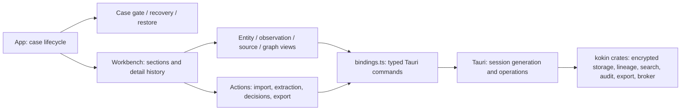

# Frontend audit — Night Ledger

Selected visual target: concept **8 — Night Ledger**, saved in the adjacent `Design concepts/08-night-ledger.png`. Concepts 1–15 remain preserved. Selection does not authorize importing other kits, replacing the backend, or treating synthetic mockup content as case facts.

## Architecture

## Inventory and classification

| Area | State | Evidence / constraints |
|---|---|---|
| Case create/open/recovery/close/restore | Operational | App, Session, CaseGate, RecoveryKey, Restore; preserve the recovery acknowledgement gate. |
| Evidence/import/extraction/static capture | Operational | Workbench + Actions; native opaque path selection tokens; explicit extraction; offline-default brokered HTTP. |
| Entities, identifiers, relationships, assessments | Operational | Typed reads and writes; supporting/opposing/context evidence; seven separate scales and recorded explanations. |
| Merge/reject/split | Operational | Existing decisions and preview; projection preserves attribution and disagreements. |
| Search and activity | Operational | Filters, paging, coverage, chain verification, disclaimer and detail history. |
| Graph | Partially operational | Bounded cancellable SVG traversal, explicit truncation, evidence links. Pan/zoom/layout controls need frontend work. |
| Export/verification | Operational | Existing native dialogs and operations; preserve exclusions, no recovery key, no signature and no-clobber restore. |
| Recent-case list, global palette, dedicated settings | Planned | No recent-case enumeration API. Do not manufacture case listings or unavailable system metrics. |
| Analytic timeline, maps, AI, PDF/media, public connectors beyond static capture | Planned | Not live frontend capabilities. Keep unavailable work out of normal navigation. |
| Legacy Evidence/Entities list components | Superseded | Workbench currently owns their entry points; leave historical files until a migration proves safe. |

Svelte 5 (installed 5.56.8), TypeScript 5, Vite 6.4.3 and Tauri 2. No routing library, centralized design tokens, component kit, graph engine, map/chart library or animation library is installed. Navigation and request invalidation are local Workbench state. `bindings.ts` owns IPC; do not introduce another invoke layer. Existing CSS is scoped plus App globals with repeated colors and dimensions.

## Baseline, 2026-10-08

Measured locally on the existing Mac checkout: `npm run check` passes with zero warnings/errors; 29 tests in five files pass; Vite build 478 ms; production CSS 16.63 kB (gzip 3.56), JS 117.18 kB (gzip 39.69). Test duration 954 ms. Build duration is not desktop startup latency or frame rate.

Baseline native screenshots and fresh Night Ledger screenshots are recorded in screenshots/. The redesigned native eleven-step offline workflow passed twice, including close/reopen and export/restore. Windows and actual startup/FPS/memory baselines remain to be recorded. See the new foundation increment report for measured build sizes, test results and screenshot constraints.

The checkout already contains substantial uncommitted core workflow and graph changes. Preserve them. No rewrite of Rust, encryption, keys, audit, provenance, network boundary or dependency-license policy is part of this rebuild.
